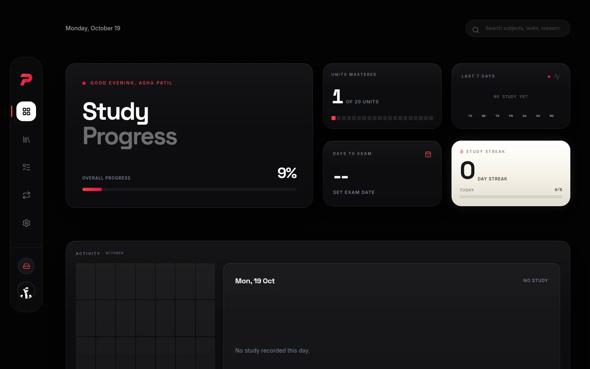
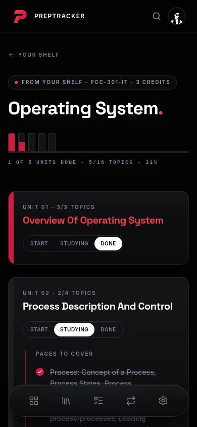
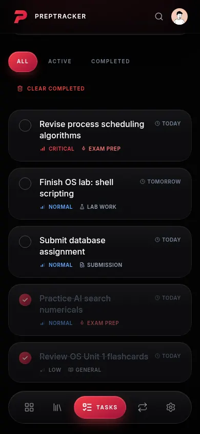

# PrepTracker

### Less "where do I start?" More syllabus covered.

A study tracker for SPPU students. Pick your subjects, tick topics as you study, and keep revision, tasks and resources in one place.

**[Open PrepTracker](https://preptracker.manavdev.site/)** · [v0.26.10.20 release notes](https://github.com/manav4u/PrepTracker/releases/tag/v0.26.10.20) · [Report an issue](https://github.com/manav4u/PrepTracker/issues)



*The live revamp, with demo study data. Desktop capture at 1440px; mobile captures below at 390px.*

## Your exam prep, in one place

- **Subjects:** choose from the available course catalog, track topics inside each unit, and see how much syllabus you have covered.
- **Dashboard:** get an overview of progress, exam dates, study streaks and a daily activity heatmap.
- **Revise:** revisit studied topics in a daily spaced-review queue. Tap "Got it" or "Forgot" to set the next review.
- **Tasks:** keep deadlines and priorities together, link work to a unit, and swipe to edit on mobile.
- **Library:** find subject resources and question-paper links, or save your own study links.
- **Make it yours:** choose from 288 avatars in six packs and four frame shapes, during setup or later in Settings.

Built for SPPU students across years, not only first year. Available subjects and resources depend on the course catalog; this is not a claim that every SPPU course is covered.

<details>
<summary>See Subjects and Tasks on mobile</summary>
<br>
<p>
  
  
</p>

*Demo data, captured at 390px. The app uses bottom navigation on mobile and a side navigation on desktop.*

</details>

## Start studying

1. [Open the app](https://preptracker.manavdev.site/) and set up your profile, or choose **Restore Backup** if you already have one.
2. Select your subjects. Open a subject and tick topics as you cover them.
3. Use **Revise** for topics due today, **Tasks** for upcoming work, and **Library** for resources.
4. Save a backup from **Settings** before changing devices or clearing browser data.

## Your data stays in this browser

No account or sign-up is needed. Your profile, syllabus progress, tasks, revision history and custom links are saved in the browser's `localStorage`.

- **No cloud sync.** Another browser or device starts separately unless you restore a backup.
- **Clearing site data can erase your work.** Export backups regularly and keep the files somewhere safe.
- **Backup and restore:** export a JSON file from Settings; share it through the device share sheet where supported. Restore during setup or in Settings, with a preview and an undo option.
- **Older files:** backup formats 3.1.0, 4.0.0 and 4.1.0 are supported alongside 4.2.0. Old 3.1.0 exports did not contain syllabus progress, so that missing progress cannot be recovered from those files.
- **Visit statistics:** the site loads Google Analytics. Browser-local study storage does not mean the site has no analytics.

The app helps you track preparation. It is not an official SPPU service, and linked resources may be hosted by third parties.

## Run locally

Use **Node.js 22.18+** and npm, matching the Node 22 workflow and its native TypeScript test support.

```bash
git clone https://github.com/manav4u/PrepTracker.git
cd PrepTracker
npm ci
npm run dev
```

Open the local URL printed by Vite.

```bash
npm run typecheck  # TypeScript checks
npm test           # Node test runner
npm run build      # Production build plus postbuild processing
npm run preview    # Preview the built site locally
```

## Project map

```text
pages/          Dashboard, Subjects, Tasks, Library, Revise and Settings
components/     Navigation, onboarding UI and shared components
context/        Profile, syllabus and saved app state
data/catalog/   Course catalog data
lib/            Backup, revision, avatars and app utilities
public/         Icons, screenshots and static assets
scripts/        Build-time processing
tests/          App logic tests
```

The app uses React 19, TypeScript and Vite, with hash-based routing for static hosting. These are implementation details, not requirements for using PrepTracker.

## Releases and deployment

**[v0.26.10.20](https://github.com/manav4u/PrepTracker/releases/tag/v0.26.10.20)** marks the live revamp: refreshed app pages and navigation, avatars, onboarding restore, updated landing screenshots and course-specific paper links.

Production is served by **GitHub Pages** at [preptracker.manavdev.site](https://preptracker.manavdev.site/). The deployment workflow runs typecheck, tests and a build before publishing `dist/` to `gh-pages`. Every push to `main` triggers it, including documentation-only changes. Pull requests to `main` run checks without publishing production.

## Contributing

Open an issue for a bug, missing subject or broken resource. Include the course, year, subject and source link where relevant. For UI bugs, add your browser and screen size, but leave private study data out of screenshots.

For code changes, work on a branch and open a pull request. Run typecheck, tests and the production build before requesting review. Keep catalog additions grounded in the relevant official syllabus.

## License

[MIT](LICENSE).
