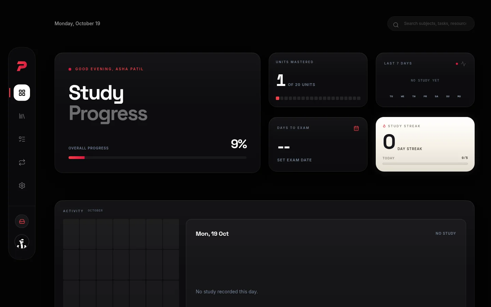
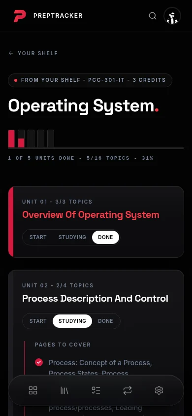
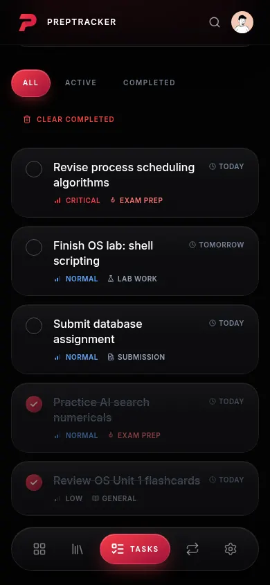
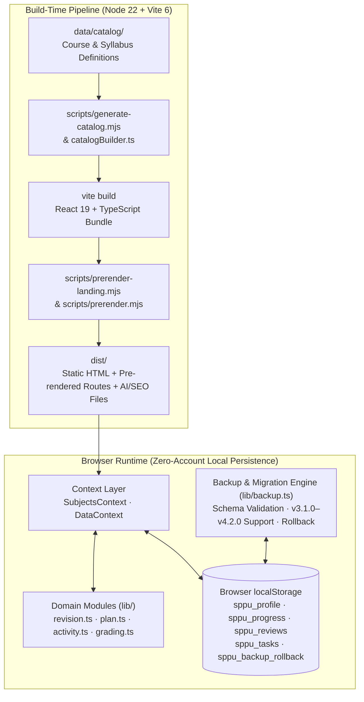

# PrepTracker

### Less "where do I start?" More syllabus covered.

[](https://github.com/manav4u/PrepTracker/actions/workflows/ci.yml)
[](https://github.com/manav4u/PrepTracker/actions/workflows/deploy.yml)

A study tracker and spaced-revision workspace for SPPU engineering students. Pick your subjects, tick topics as you study, and keep revision, tasks, and syllabus resources in one browser-local workspace.

**[Open PrepTracker](https://preptracker.manavdev.site/)** · [v0.26.10.20 release notes](https://github.com/manav4u/PrepTracker/releases/tag/v0.26.10.20) · [Report an issue](https://github.com/manav4u/PrepTracker/issues)



*The live revamp, with demo study data. Desktop capture at 1440px; mobile captures below at 390px.*

---

## Your exam prep, in one place

- **Subjects:** choose from the available course catalog, track topics inside each unit, and see how much syllabus you have covered.
- **Dashboard:** get an overview of progress, exam dates, study streaks and a daily activity heatmap.
- **Revise:** revisit studied topics in a daily spaced-review queue. Tap "Got it" or "Forgot" to set the next review.
- **Tasks:** keep deadlines and priorities together, link work to a unit, and swipe to edit on mobile.
- **Library:** find subject resources and question-paper links, or save your own study links.
- **Make it yours:** choose from 288 avatars in six packs and four frame shapes, during setup or later in Settings.

Built for SPPU students across years, not only first year. Available subjects and resources depend on the course catalog; this is not a claim that every SPPU course is covered.

<details>
<summary>See Subjects and Tasks on mobile</summary>
<br>
<p>
  
  
</p>

*Demo data, captured at 390px. The app uses bottom navigation on mobile and a side navigation on desktop.*

</details>

---

## Start studying

1. [Open the app](https://preptracker.manavdev.site/) and set up your profile, or choose **Restore Backup** if you already have one.
2. Select your subjects. Open a subject and tick topics as you cover them.
3. Use **Revise** for topics due today, **Tasks** for upcoming work, and **Library** for resources.
4. Save a backup from **Settings** before changing devices or clearing browser data.

---

## System Architecture

PrepTracker combines a multi-stage static build pipeline (for indexable syllabus and landing pages) with a zero-backend React 19 client application backed by schema-validated `localStorage`.



### Project Map

```text
pages/          Dashboard, Subjects, Tasks, Library, Revise and Settings views
components/     Navigation, onboarding UI, restore modals and shared components
context/        DataContext and SubjectsContext (profile, syllabus and saved app state)
data/catalog/   Structured SPPU course and unit catalog data
lib/            Pure domain logic: backup/restore, spaced revision, study planner, grading, activity
public/         Icons, landing screenshots, service worker and static assets
scripts/        Catalog generation, static route pre-rendering and postbuild processing
tests/          14 Node native TypeScript unit test suites for domain logic
e2e/            11 Playwright end-to-end and axe-core accessibility test specs
```

---

## Engineering Decisions & Trade-offs

### 1. Zero-Account Local Persistence + Schema-Versioned Backup & Rollback (`lib/backup.ts`)
- **Decision:** Store student progress, tasks, marks, custom resources, and revision schedules directly in browser `localStorage` rather than requiring OAuth or a cloud database.
- **Why:** Students opening a syllabus tracker before exams want immediate utility without account sign-up friction.
- **Mitigating data-loss risk:** Because `localStorage` is tied to a single browser profile, `lib/backup.ts` implements a strict, schema-validated JSON export/import engine:
  - Validates every imported entity (`profile`, `progress`, `tasks`, `resources`, `marks`, `hiddenResourceIds`, `reviews`) against runtime type guards and size limits (`MAX_BYTES = 5 MB`) before mutating state.
  - Maintains backward compatibility across backup formats `3.1.0`, `4.0.0`, `4.1.0`, and `4.2.0` (explicitly handling legacy `3.1.0` files that lacked progress keys and clearing stale review schedules when restoring pre-`4.1.0` snapshots).
  - Snapshots the pre-restore state into `sppu_backup_rollback` prior to applying an import, giving users a one-click **Undo Restore** safety net.

### 2. Derived Spaced-Repetition Queue (`lib/revision.ts`)
- **Decision:** Compute the daily review queue (`buildQueue`) as a pure function of ticked syllabus topics, study activity timestamps, and a minimal per-topic review record (`stage`, `due`, `last`, `shaky`).
- **Why:** If the revision queue duplicated the syllabus tree, ticking or unticking topics in the `Subjects` view would cause synchronization bugs. By deriving queue membership from `progress` and `events`, unticking a topic automatically removes it from active review without extra bookkeeping.
- **Scheduling mechanics:** Uses increasing recall intervals (`STEPS = [3, 7, 21]` days), resets "shaky" recalls to `SHAKY_DAYS = 1`, and enforces `DAILY_CAP = 8` reviews per day (with overdue prioritization) so students returning after a break are not overwhelmed by a 50-item backlog.

### 3. Hybrid Static Pre-rendering + Hash App Routing (`scripts/prerender*.mjs`)
- **Decision:** Use hash-based routing (`#/dashboard`, `#/subjects`, etc.) for the interactive tracker while pre-rendering static HTML pages for the landing page, branch syllabus hubs, and info pages at build time.
- **Why:** GitHub Pages serves static files without custom server-side rewrites. Pre-rendering syllabus and landing routes gives fast initial paint and search/share metadata, while hash routing guarantees client-side navigation never hits a 404 on static hosting.

---

## Your data stays in this browser

No account or sign-up is needed. Your profile, syllabus progress, tasks, revision history and custom links are saved in the browser's `localStorage`.

- **No cloud sync.** Another browser or device starts separately unless you restore a backup.
- **Clearing site data can erase your work.** Export backups regularly and keep the files somewhere safe.
- **Backup and restore:** export a JSON file from Settings; share it through the device share sheet where supported. Restore during setup or in Settings, with a preview and an undo option.
- **Older files:** backup formats `3.1.0`, `4.0.0` and `4.1.0` are supported alongside `4.2.0`. Old `3.1.0` exports did not contain syllabus progress, so that missing progress cannot be recovered from those files.
- **Visit statistics:** the site loads Google Analytics. Browser-local study storage does not mean the site has no analytics.

The app helps you track preparation. It is not an official SPPU service, and linked resources may be hosted by third parties.

---

## Run locally & verify

Use **Node.js 22.18+** and npm, matching the Node 22 CI workflow and its native TypeScript test execution.

```bash
git clone https://github.com/manav4u/PrepTracker.git
cd PrepTracker
npm ci
npm run dev
```

### Quality Assurance & Test Suites

Every pull request and push to `main` runs automated checks via GitHub Actions (`.github/workflows/ci.yml` and `.github/workflows/deploy.yml`):

```bash
npm run typecheck  # TypeScript strict compiler check (tsc --noEmit)
npm test           # 14 unit test suites via Node's native TypeScript test runner
npm run build      # Catalog generation, Vite build, postbuild & static pre-rendering
npm run test:e2e   # 11 Playwright E2E + axe-core accessibility specs
```

- **Unit test coverage (`tests/*.test.ts`):** Covers backup validation/migration/rollback (`backup.test.ts`), spaced-repetition scheduling and daily caps (`revision.test.ts`), study plan date distribution (`plan.test.ts`), streak & heatmap calculation (`activity.test.ts`), grading (`grading.test.ts`), catalog integrity (`catalog.test.ts`), and markdown/AI export generation.
- **End-to-end & accessibility coverage (`e2e/*.spec.ts`):** Verifies onboarding tour, subject switching, task editing, study-plan goal adjustments, service-worker offline fallback (`sw-offline.spec.ts`), analytics consent isolation (`consent.spec.ts`), and automated `axe-core` WCAG checks (`a11y.spec.ts`).

---

## Releases and deployment

**[v0.26.10.20](https://github.com/manav4u/PrepTracker/releases/tag/v0.26.10.20)** marks the live revamp: refreshed app pages and navigation, avatars, onboarding restore, updated landing screenshots and course-specific paper links.

Production is served by **GitHub Pages** at [preptracker.manavdev.site](https://preptracker.manavdev.site/). The deployment workflow runs `typecheck`, `test`, and `build` before publishing `dist/` to `gh-pages`. Pull requests to `main` run the full check + Playwright E2E suite without publishing to production.

---

## Contributing

Open an issue for a bug, missing subject or broken resource. Include the course, year, subject and source link where relevant. For UI bugs, add your browser and screen size, but leave private study data out of screenshots.

For code changes, work on a branch and open a pull request. Run `npm run typecheck`, `npm test`, and `npm run build` before requesting review. Keep catalog additions grounded in the relevant official syllabus.

## License

[MIT](LICENSE).
