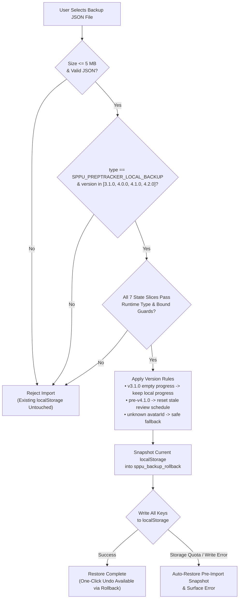

# PrepTracker Architecture & Decision Records (ADRs)

This document records the core architectural decisions, data models, backup migration rules, and security/privacy boundaries in **PrepTracker**.

---

## 1. Architecture Decision Records

### ADR-001: Local-First Browser Persistence with Schema-Versioned Backups vs. Cloud Database

- **Status:** Accepted
- **Context:** PrepTracker serves university engineering students tracking syllabus coverage, exam countdowns, tasks, and revision queues across a semester. Traditional study trackers require OAuth/email sign-up and a backend database before a student can tick a single syllabus topic.
- **Decision:** Store all user state (`profile`, `progress`, `tasks`, `resources`, `marks`, `hiddenResourceIds`, `reviews`) locally in browser `localStorage` under a single canonical key map (`KEYS` in [`lib/backup.ts`](../../lib/backup.ts)), paired with a schema-validated JSON backup/restore and rollback engine.
- **Alternatives Considered:**
  1. *Managed backend (Supabase / Firebase Auth + Firestore):* Enables automatic multi-device sync, but introduces mandatory sign-up friction, server/database hosting costs, and third-party storage of student academic records.
  2. *Unvalidated `localStorage` dump:* Simple to implement, but brittle when schema shapes evolve across releases or when users import malformed JSON files.
- **Consequences & Mitigations:**
  - *Zero onboarding friction:* Students can open the app and start tracking immediately; the app also works offline after initial visit.
  - *Mitigating local data loss:* Clearing site data or switching browsers does not automatically transfer state. To mitigate this, [`lib/backup.ts`](../../lib/backup.ts) implements:
    1. **Strict runtime schema validation (`checks`):** Every field is validated against structural type guards and length/size bounds (`MAX_BYTES = 5 MB`) prior to writing to `localStorage`.
    2. **Multi-version migration (`3.1.0` → `4.2.0`):** Supports importing legacy backup formats without silently corrupting current state.
    3. **Atomic rollback (`sppu_backup_rollback`):** Snapshots existing `localStorage` state before applying any import so users can undo a restore with one click.

---

### ADR-002: Derived Spaced-Repetition Queue vs. Duplicated Review State

- **Status:** Accepted
- **Context:** When a student ticks a topic in the `Subjects` view, that topic should enter a spaced-repetition review schedule (`Revise` view). If the student later unticks that topic or switches active subjects, the review queue must reflect that change immediately.
- **Decision:** Implement `buildQueue` in [`lib/revision.ts`](../../lib/revision.ts) as a pure function of `(subjects, selectedSubjects, progress, activityEvents, reviews, now)`. Only minimal review-outcome metadata (`stage`, `due`, `last`, `shaky`) is persisted in `sppu_reviews` keyed by `${unitId}::${topic}`.
- **Alternatives Considered:**
  - *Independent review item table:* Inserting and deleting full topic objects into a separate `review_items` store whenever a checkbox is toggled. Rejected because partial updates or legacy backup imports could leave orphaned review cards for unticked topics.
- **Algorithm Mechanics:**
  - **Initial scheduling:** A newly studied topic without an existing review entry derives its initial study date from the activity log (`studiedOn`) and becomes due in `STEPS[0] = 3` days.
  - **Graduated intervals:** Recalling a topic ("Got it") advances `stage` along `STEPS = [3, 7, 21]` days; completing the final stage (`stage >= 3`) graduates the topic (`due = ''`).
  - **Shaky recall recovery:** Marking a topic "Forgot / Shaky" resets `stage = 0`, sets `shaky = true`, and schedules the next review for tomorrow (`SHAKY_DAYS = 1`).
  - **Backlog protection (`DAILY_CAP = 8`):** Caps the active daily queue at 8 items (sorting shaky and most-overdue topics first) while holding remaining due items in `waiting` so returning after an exam break never presents an unmanageable wall of cards.

---

### ADR-003: Hybrid Static Pre-rendering + Hash Routing for Static Hosting

- **Status:** Accepted
- **Context:** PrepTracker is deployed on GitHub Pages (`preptracker.manavdev.site`), which serves static assets without dynamic server-side route rewrites. At the same time, public syllabus reference pages, branch hubs, and landing pages need clean URLs and indexable metadata.
- **Decision:**
  1. Run a build-time pre-rendering pipeline ([`scripts/generate-catalog.mjs`](../../scripts/generate-catalog.mjs), [`scripts/prerender-landing.mjs`](../../scripts/prerender-landing.mjs), [`scripts/prerender.mjs`](../../scripts/prerender.mjs)) that emits static HTML files for landing, privacy, research, and syllabus reference routes.
  2. Use client-side hash routing (`#/dashboard`, `#/subjects`, `#/revise`, `#/tasks`, `#/library`, `#/settings`) inside the interactive React 19 application.
- **Consequences:** Static routes load with zero client-side data-fetching delay and full SEO/OpenGraph metadata, while interactive app views never trigger 404 errors on refresh under static hosting.

---

## 2. Data Model & Backup Migration Reference (`lib/backup.ts`)

### Canonical `localStorage` Keys

| Field | Storage Key | Type / Validation Summary |
| :--- | :--- | :--- |
| `profile` | `sppu_profile` | `{ name, selectedSubjects, setupComplete, theme, streak, lastStudyDate, avatarId?, avatarShape? } \| null` |
| `progress` | `sppu_progress` | `Array<{ unitId, status, pyqsCompleted, topicsDone? }>` where `status ∈ ['Not Started', 'In Progress', 'Revision', 'Mastered']` |
| `tasks` | `sppu_tasks` | `Array<{ id, text, completed, priority, category, createdAt, dueDate?, unitId? }>` |
| `resources` | `sppu_custom_resources` | `Array<{ id, title, author, downloads, subject, category, url, type }>` (`https?://` enforced) |
| `marks` | `sppu_calculator_marks` | Credit/grade calculator state validated via `cleanMarks(x)` |
| `hiddenResourceIds` | `sppu_deleted_system_ids` | `string[]` of dismissed default catalog resource IDs |
| `reviews` | `sppu_reviews` | `Record<"${unitId}::${topic}", { stage, due, last, shaky? }>` validated via `isReviews` |

### Version Migration Behavior (`3.1.0` → `4.2.0`)

| Backup Version | Format Differences | Restore Migration Rule in `lib/backup.ts` |
| :--- | :--- | :--- |
| **`3.1.0`** *(legacy)* | Early exporter read an unused progress key, producing files with empty `progress: []`. Lacked `reviews` and `avatarId`. | Preserves the user's existing in-browser `sppu_progress` when importing a `3.1.0` file with empty progress so a legacy restore never wipes current syllabus ticks. |
| **`4.0.0`** | Exports canonical `sppu_progress`. Does not include `reviews`. | Restores `progress` and clears `sppu_reviews` (`{}`) so stale review schedules from a previous profile do not mix with imported progress. |
| **`4.1.0`** | Adds `reviews` (`sppu_reviews`) schedule map. | Validates and restores `reviews`; defaults missing avatar fields safely. |
| **`4.2.0`** *(current)* | Adds validated `avatarId` (288 local catalog IDs) and `avatarShape` presets. | Full round-trip restore with unknown/hostile avatar IDs falling back safely without rejecting valid study progress. |

A complete multi-version migration test fixture is available in [`fixtures/backup-v3.1.0-to-v4.2.0.json`](fixtures/backup-v3.1.0-to-v4.2.0.json) and exercised automatically by [`tests/backup.test.ts`](../../tests/backup.test.ts).

### Backup Restore & Rollback Transaction Flow

---

## 3. Security & Privacy Considerations

1. **Untrusted Backup Input Validation:** Imported backup JSON files are treated as untrusted input. Files exceeding `MAX_BYTES` (5 MB), containing non-plain objects, strings over 10,000 characters, non-`http(s)` resource URLs, or arbitrary external avatar paths are rejected before touching `localStorage`.
2. **Transactional Restore & Rollback:** If writing any key to `localStorage` fails (e.g., quota exceeded), `restoreBackup` catches the failure and re-applies the pre-restore snapshot so storage is never left in a half-written state.
3. **Analytics Consent Isolation:** Study data never leaves the browser. Visit analytics (Google Analytics) and error reporting are gated by consent checks tested in [`e2e/consent.spec.ts`](../../e2e/consent.spec.ts) and [`e2e/sentry-defer.spec.ts`](../../e2e/sentry-defer.spec.ts).
